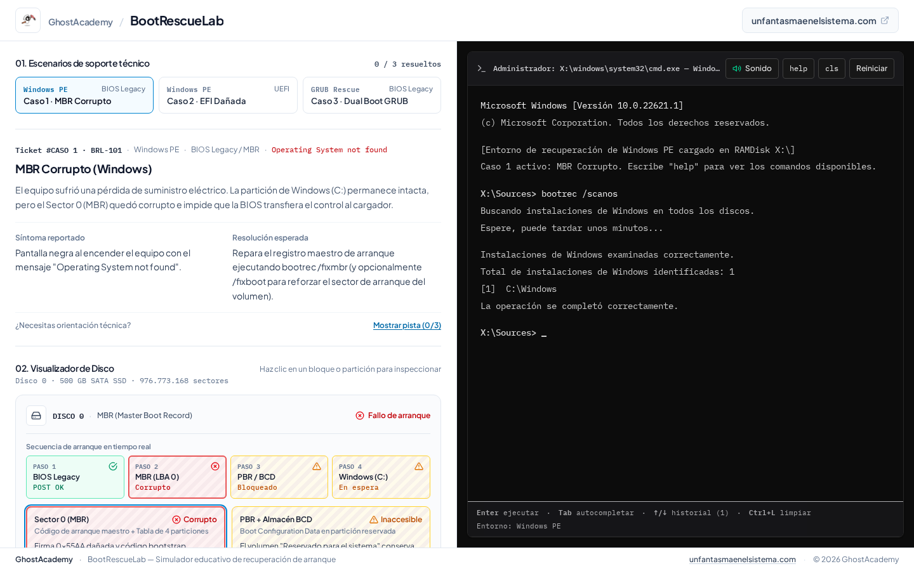
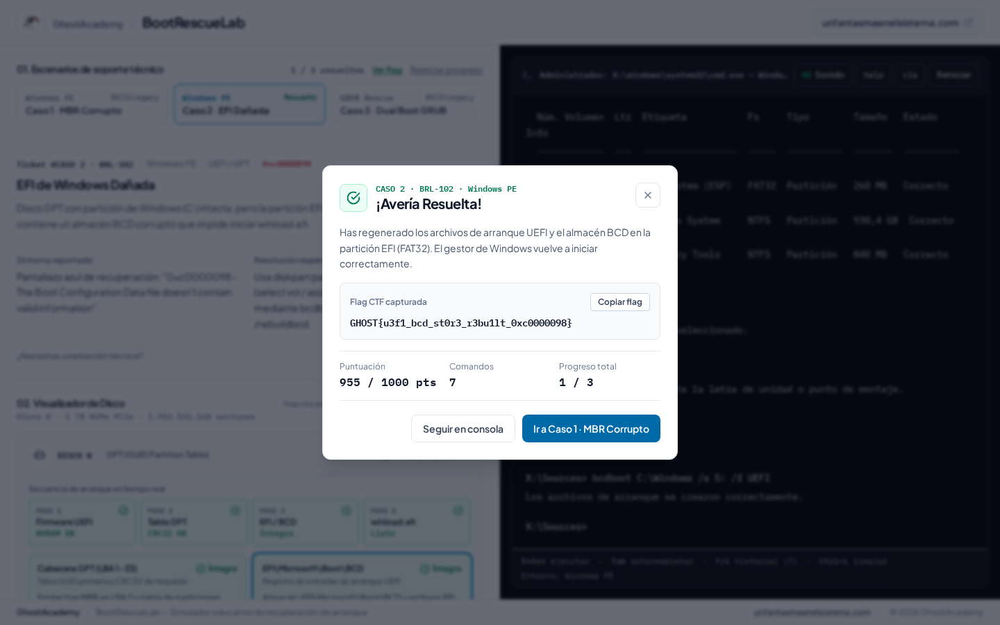

# BootRescueLab — GhostAcademy

Laboratorio educativo interactivo **100% cliente-estático** (HTML5, Tailwind CSS y Vanilla JavaScript) diseñado para practicar el diagnóstico y la reparación de fallos críticos de arranque en **Windows PE** y **GNU GRUB Rescue**, desarrollado para el portal **[GhostAcademy — Un Fantasma en el Sistema](https://www.unfantasmaenelsistema.com/)**.

---

## Capturas reales de la aplicación

### 1. Caso 1 — MBR Corrupto en Windows PE y Visualizador de Disco en vivo
El panel izquierdo muestra el estado físico del **Disco 0**, la secuencia de arranque paso a paso y el bloque `Sector 0 (MBR)` en alerta roja hasta que el alumno lo repara desde la consola interactiva.



### 2. Caso 2 — Reparación UEFI / EFI con DiskPart y modal CTF de victoria
Tras asignar letra a la partición EFI (`diskpart` → `assign letter=S`) y regenerar los archivos de arranque con `bcdboot`, el Visualizador de Disco pasa a verde íntegro y se desbloquea la flag CTF junto con la puntuación obtenida.



### 3. Caso 3 — Dual Boot pisado en entorno GNU GRUB Rescue
El emulador cambia automáticamente al tema y prompt `grub rescue>`, permitiendo listar particiones (`ls`), explorar `/boot/grub`, reconfigurar `root` y `prefix`, cargar `insmod normal` y arrancar el menú de GNU GRUB.


### 4. Diseño responsive para dispositivos móviles
En pantallas estrechas la consola interactiva se apila debajo del panel de diagnóstico y del Visualizador de Disco manteniendo la legibilidad y los controles táctiles.

<p align="center">
  
</p>

---

## Características principales

- **Sin backend ni dependencias de servidor:** Funciona directamente como aplicación estática lista para **GitHub Pages**.
- **Visualizador de Disco interactivo en tiempo real:**
  - Representación gráfica de **LBA 0 (MBR / GPT)**, particiones proporcionales y secuencia de arranque en 4 pasos.
  - Cambio visual instantáneo de **rojo con pulso de advertencia** a **verde íntegro** al ejecutar comandos reparadores (`bootrec /fixmbr`, `bcdboot`, `bootrec /rebuildbcd`, `insmod normal`, `normal`).
  - Inspector técnico detallado con firmas de sector (`0x55AA`), rangos LBA, sistema de archivos, rutas EFI y variables de GRUB.
- **Emulador de consola realista con dos temas:**
  - **Windows PE (`X:\Sources>`):** `bootrec` (`/fixmbr`, `/fixboot`, `/scanos`, `/rebuildbcd`), `bcdboot`, `bcdedit`, `diskpart` (`list disk`, `list vol`, `list part`, `select`, `detail`, `assign letter`, `remove letter`, `format fs=fat32 quick`, `active`, `exit`), `chkdsk`, `dir`, `cd`, `type`, `ver`, `cls`, `history`, `exit`.
  - **GRUB Rescue (`grub rescue>`):** `ls`, `ls (hdX,Y)/ruta`, `cat (hdX,Y)/boot/grub/grub.cfg`, `set`, `set root=...`, `set prefix=...`, `insmod normal`, `normal`, `clear`, `history`, `reboot`.
  - **Productividad de terminal:** Autocompletado con `Tab`, historial con `↑`/`↓`, limpieza rápida con `Ctrl+L` y scroll automático.
- **Motor CTF y herramientas educativas:**
  - Verificación automática de resolución por escenario, puntuación dinámica, flags copiables y persistencia de progreso en `localStorage`.
  - **Pistas progresivas** opcionales (3 niveles por caso) y **chuleta técnica interactiva** con inserción directa en consola.
- **Efectos de sonido sutiles (Web Audio API):** Pulsaciones de teclado, confirmación de reparación, error y fanfarria CTF sin archivos externos, activable o silenciable desde la barra de consola.

---

## Escenarios incluidos

| Caso | Entorno | Síntoma inicial | Resolución esperada |
| :--- | :--- | :--- | :--- |
| **Caso 1 · MBR Corrupto** | Windows PE (`BIOS / MBR`) | Pantalla negra: `Operating System not found` | `bootrec /fixmbr` (y opcionalmente `bootrec /fixboot`) |
| **Caso 2 · EFI de Windows Dañada** | Windows PE (`UEFI / GPT`) | Pantallazo azul `0xc0000098` (BCD inválido) | `diskpart` (`select vol 0`, `assign letter=S`) + `bcdboot C:\Windows /s S: /f UEFI` o `bootrec /rebuildbcd` |
| **Caso 3 · Dual Boot Pisado** | GRUB Rescue (`BIOS / MBR`) | `error: no such partition` en `grub rescue>` | `ls` → `set root=(hd0,msdos2)` → `set prefix=(hd0,msdos2)/boot/grub` → `insmod normal` → `normal` |

---

## Estructura del proyecto

```text
BootRescueLab/
├── index.html                    # Estructura principal, paneles educativos, modal CTF y footer
├── styles.css                    # Tailwind CSS v4, temas de terminal y animaciones de sectores
├── app.js                        # Motor de escenarios, simulador WinPE/GRUB, Web Audio y Visualizador
├── public/
│   └── assets/aistudio/          # Logotipo oficial de GhostAcademy
├── docs/
│   └── screenshots/              # Capturas reales de la aplicación para documentación
├── .github/workflows/
│   └── deploy.yml                # Despliegue automático a GitHub Pages
├── package.json
├── vite.config.ts                # Configurado con base: './' para rutas relativas en GitHub Pages
└── LICENSE
```

---

## Desarrollo local y despliegue en GitHub Pages

### Requisitos
- Node.js 20 o superior.

### Ejecutar en local
```bash
npm install
npm run dev
```
La aplicación quedará disponible en `http://localhost:3000`.

### Compilar versión estática
```bash
npm run build
```
Generará los archivos estáticos optimizados en la carpeta `dist/`.

### Publicar en GitHub Pages
Este repositorio incluye el flujo automático `.github/workflows/deploy.yml`:
1. Sube el proyecto a la rama `main` de tu repositorio en GitHub.
2. En **Settings → Pages → Build and deployment**, selecciona **GitHub Actions** como origen (*Source*).
3. Cada `git push` a `main` compilará `dist/` y publicará la web automáticamente.

---

## Autoría y licencia

Desarrollado para **[GhostAcademy — unfantasmaenelsistema.com](https://www.unfantasmaenelsistema.com/)**.  
Distribuido bajo licencia [MIT](./LICENSE).
