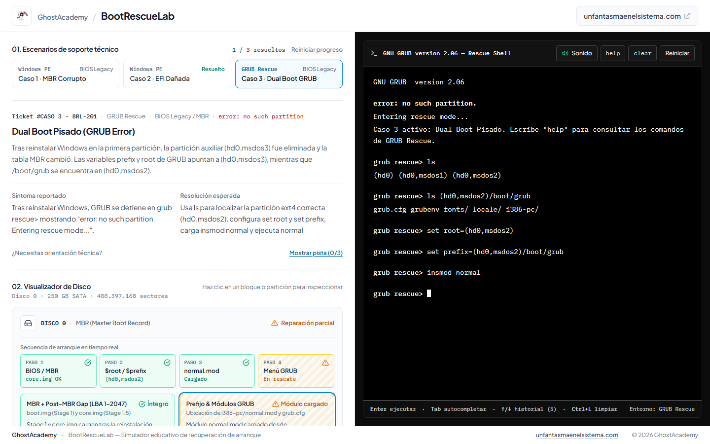
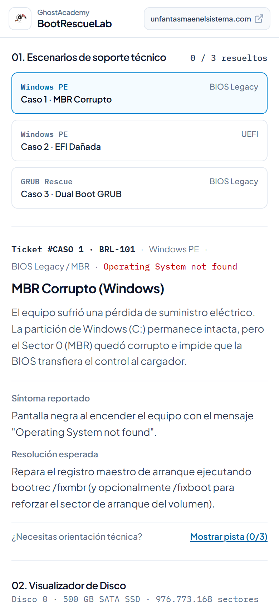

<div align="center">
  <a href="https://www.unfantasmaenelsistema.com/">
    
  </a>

# BootRescueLab — GhostAcademy

[](https://unfantasmaenelsistema.github.io/BootRescueLab/)
[](#estructura-del-proyecto)
[](./LICENSE)

**[▶ Abrir el laboratorio](https://unfantasmaenelsistema.github.io/BootRescueLab/)**
</div>

Laboratorio educativo interactivo **100% cliente-estático** (HTML5, Tailwind CSS y Vanilla JavaScript) diseñado para practicar el diagnóstico y la reparación de fallos críticos de arranque en **Windows PE** y **GNU GRUB Rescue**, desarrollado para el portal **[GhostAcademy — Un Fantasma en el Sistema](https://www.unfantasmaenelsistema.com/)**.

---

## Tabla de contenidos

- [Capturas reales de la aplicación](#capturas-reales-de-la-aplicación)
- [Características principales](#características-principales)
- [Escenarios incluidos](#escenarios-incluidos)
- [Estructura del proyecto](#estructura-del-proyecto)
- [Desarrollo local y despliegue en GitHub Pages](#desarrollo-local-y-despliegue-en-github-pages)
- [Novedades de la versión 2](#novedades-de-la-versión-2)
- [Autoría y licencia](#autoría-y-licencia)

---

## Capturas reales de la aplicación

> Capturas de la versión 2 tomadas sobre la compilación de producción, ejecutando los comandos de verdad en la consola.

### 1. Caso 1 — MBR Corrupto en Windows PE y Visualizador de Disco en vivo
El panel izquierdo muestra el estado físico del **Disco 0**, la secuencia de arranque paso a paso y el bloque `Sector 0 (MBR)` en alerta roja hasta que el alumno lo repara desde la consola interactiva.


### 2. Caso 2 — Reparación UEFI / EFI con DiskPart y modal CTF de victoria
Tras asignar letra a la partición EFI (`diskpart` → `assign letter=S`) y regenerar los archivos de arranque con `bcdboot`, el Visualizador de Disco pasa a verde íntegro y se desbloquea la flag CTF junto con la puntuación obtenida.


### 3. Caso 3 — Dual Boot pisado en entorno GNU GRUB Rescue
El emulador cambia automáticamente al tema y prompt `grub rescue>`, permitiendo listar particiones (`ls`), explorar `/boot/grub`, reconfigurar `root` y `prefix`, cargar `insmod normal` y arrancar el menú de GNU GRUB.



### 4. Diseño responsive para dispositivos móviles
En pantallas estrechas la consola interactiva se apila debajo del panel de diagnóstico y del Visualizador de Disco manteniendo la legibilidad y los controles táctiles.

<p align="center">
  
</p>

---

## Características principales

- **Sin backend ni dependencias de servidor:** Funciona directamente como aplicación estática lista para **GitHub Pages**.
- **Visualizador de Disco interactivo en tiempo real:**
  - Representación gráfica de **LBA 0 (MBR / GPT)**, particiones proporcionales y secuencia de arranque en 4 pasos.
  - Cambio visual instantáneo de **rojo con pulso de advertencia** a **verde íntegro** al ejecutar comandos reparadores (`bootrec /fixmbr`, `bcdboot`, `bootrec /rebuildbcd`, `insmod normal`, `normal`).
  - Inspector técnico detallado con firmas de sector (`0x55AA`), rangos LBA, sistema de archivos, rutas EFI y variables de GRUB.
- **Emulador de consola realista con dos temas:**
  - **Windows PE (`X:\Sources>`):** `bootrec` (`/fixmbr`, `/fixboot`, `/scanos`, `/rebuildbcd`), `bcdboot`, `bcdedit`, `diskpart` (`list disk`, `list vol`, `list part`, `select`, `detail`, `assign letter`, `remove letter`, `format fs=fat32 quick`, `active`, `exit`), `chkdsk`, `dir`, `cd`, `type`, `ver`, `cls`, `history`, `exit`.
  - **GRUB Rescue (`grub rescue>`):** `ls`, `ls (hdX,Y)/ruta`, `cat (hdX,Y)/boot/grub/grub.cfg`, `set`, `set root=...`, `set prefix=...`, `insmod normal`, `normal`, `clear`, `history`, `reboot`.
  - **Productividad de terminal:** Autocompletado con `Tab`, historial con `↑`/`↓`, limpieza rápida con `Ctrl+L` y scroll automático.
- **Motor CTF y herramientas educativas:**
  - Verificación automática de resolución por escenario, puntuación dinámica, flags copiables y persistencia de progreso en `localStorage`. Al cargar el progreso solo se aceptan los casos que existen y cuya flag es la del propio caso, así que editar `localStorage` no marca casos como resueltos.
  - **Pistas progresivas** opcionales (3 niveles por caso) y **chuleta técnica interactiva** con inserción directa en consola.
- **Efectos de sonido sutiles (Web Audio API):** Pulsaciones de teclado, confirmación de reparación, error y fanfarria CTF sin archivos externos, activable o silenciable desde la barra de consola.

---

## Escenarios incluidos

| Caso | Entorno | Síntoma inicial | Resolución esperada |
| :--- | :--- | :--- | :--- |
| **Caso 1 · MBR Corrupto** | Windows PE (`BIOS / MBR`) | Pantalla negra: `Operating System not found` | `bootrec /fixmbr` (y opcionalmente `bootrec /fixboot`) |
| **Caso 2 · EFI de Windows Dañada** | Windows PE (`UEFI / GPT`) | Pantallazo azul `0xc0000098` (BCD inválido) | `diskpart` (`select vol 0`, `assign letter=S`) + `bcdboot C:\Windows /s S: /f UEFI` o `bootrec /rebuildbcd` |
| **Caso 3 · Dual Boot Pisado** | GRUB Rescue (`BIOS / MBR`) | `error: no such partition` en `grub rescue>` | `ls` → `set root=(hd0,msdos2)` → `set prefix=(hd0,msdos2)/boot/grub` → `insmod normal` → `normal` |

---

## Estructura del proyecto

```text
BootRescueLab/
├── index.html                    # Estructura principal, paneles educativos, modal CTF y footer
├── styles.css                    # Tailwind CSS v4 (compilado en el build), temas de terminal y animaciones
├── app.js                        # Motor de escenarios, simulador WinPE/GRUB, Web Audio y Visualizador
├── public/
│   └── assets/logo.png           # Logotipo de GhostAcademy (también favicon)
├── docs/
│   └── screenshots/              # Capturas reales de la aplicación para documentación
├── .github/workflows/
│   └── deploy.yml                # Despliegue automático a GitHub Pages
├── package.json / bun.lock       # Dependencias de compilación (Bun)
├── vite.config.js                # base: './' para rutas relativas en GitHub Pages
└── LICENSE
```

---

## Desarrollo local y despliegue en GitHub Pages

Requisitos: **[Bun](https://bun.sh/)** (el proyecto usa `bun.lock`).

```bash
git clone https://github.com/unfantasmaenelsistema/BootRescueLab.git
cd BootRescueLab
bun install
bun run dev        # http://localhost:3000
bun run build      # genera ./dist para publicar
```

Abrir `index.html` directamente no basta: los estilos de Tailwind se generan al compilar.

El flujo [`.github/workflows/deploy.yml`](./.github/workflows/deploy.yml) se ejecuta en cada `push` a `main`: instala con Bun (`bun install --frozen-lockfile`), compila `./dist` y lo publica en https://unfantasmaenelsistema.github.io/BootRescueLab/ (en **Settings → Pages**, la fuente es **GitHub Actions**).

---

## Novedades de la versión 2

- **Publicado en GitHub Pages.** El workflow fallaba en segundos (`npm ci` sin `package-lock.json`) y Pages no estaba activado. Ahora compila con Bun y publica.
- **Progreso CTF que no se puede inventar.** Cualquier clave o flag escrita a mano en `localStorage` contaba como caso resuelto (se llegaba a «3 / 3» sin jugar). Ahora solo cuentan los tres casos reales con su flag correcta.
- **Limpieza.** Fuera React, Gemini, Express, `motion`, `lucide-react`, TypeScript y el plugin de copia de AI Studio, que la app (HTML + JavaScript) no usaba, además de `metadata.json` y `.env.example`. El logo pasa a `public/assets/logo.png` y es también el favicon. El aspecto no cambia: lo he comparado píxel a píxel en los tres casos y en la pantalla de victoria, en escritorio y en móvil.

---

## Autoría y licencia

Desarrollado para **[GhostAcademy — unfantasmaenelsistema.com](https://www.unfantasmaenelsistema.com/)**.  
Distribuido bajo licencia [MIT](./LICENSE).
